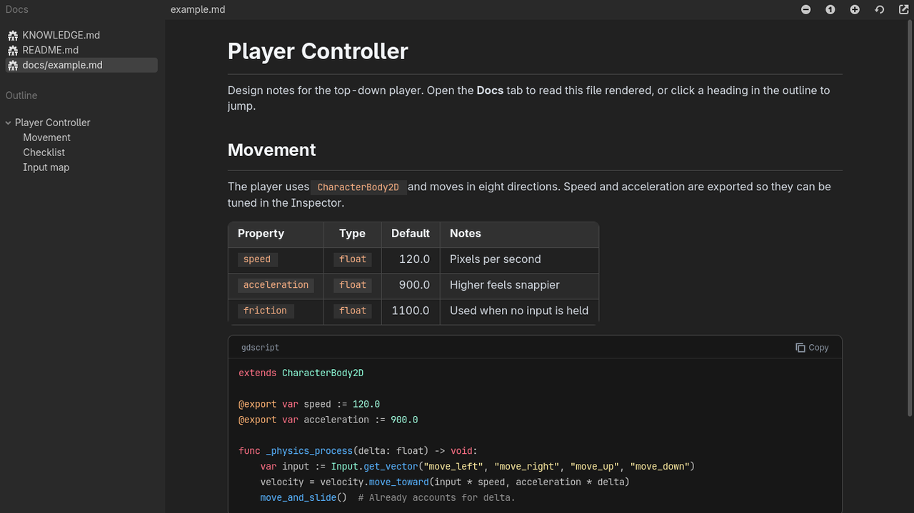

# Markdown Docs Viewer

A Godot 4 editor plugin that adds a **Docs** tab next to 2D, 3D and Script. It renders the Markdown files in your project so you can read notes, design docs and READMEs without leaving the editor.



## Features

- Lists every `.md` file in the project and shows a clickable outline of its headings.
- Tables with column alignment and alternating row colors.
- Fenced code blocks with syntax highlighting that uses your editor's text editor colors, plus a copy button.
- Inline code, **bold**, *italic*, ~~strikethrough~~, task lists, nested lists, blockquotes and horizontal rules.
- Links: web links open in the browser, links to other `.md` files open in the viewer, and `#anchor` links jump to headings (CJK headings included).
- Follows the editor's light or dark theme.
- `Ctrl + Mouse Wheel` to zoom. The page refreshes automatically when the file changes.
- UI in English and Chinese, chosen from the editor language.

## Installation

1. Copy `addons/markdown_docs_viewer` into your project's `addons/` folder.
2. Enable **Markdown Docs Viewer** in **Project > Project Settings > Plugins**.
3. Click the **Docs** tab at the top of the editor.

## Supported syntax

| Element | Syntax | Supported |
| --- | --- | :---: |
| Headings | `# H1` to `###### H6` | ✅ |
| Tables | Pipe tables with `:---:` alignment | ✅ |
| Code blocks | ```` ```gdscript ```` | ✅ |
| Task lists | `- [ ]` / `- [x]` | ✅ |
| Images | `` | ❌ |
| Raw HTML | `<div>` | ❌ |

Code blocks tagged `gdscript`, `python`, `csharp`, `js`, `json`, `glsl` or `shader` get keyword highlighting. `ini`, `cfg`, `toml`, `tscn` and `tres` get config-style highlighting.

```gdscript
@tool
extends EditorPlugin

func _has_main_screen() -> bool:
    return true  # Adds a tab next to 2D / 3D / Script.
```

## Limitations

- Read-only. Edit the files in the Script editor or an external editor.
- Images and raw HTML are not rendered. HTML comments are hidden.
- Files inside `addons/` and hidden folders are not listed.

## Compatibility

Tested on Godot 4.7. Pure GDScript, no compiled code.

## License

[MIT](LICENSE) © 2026 Soybean-milk
